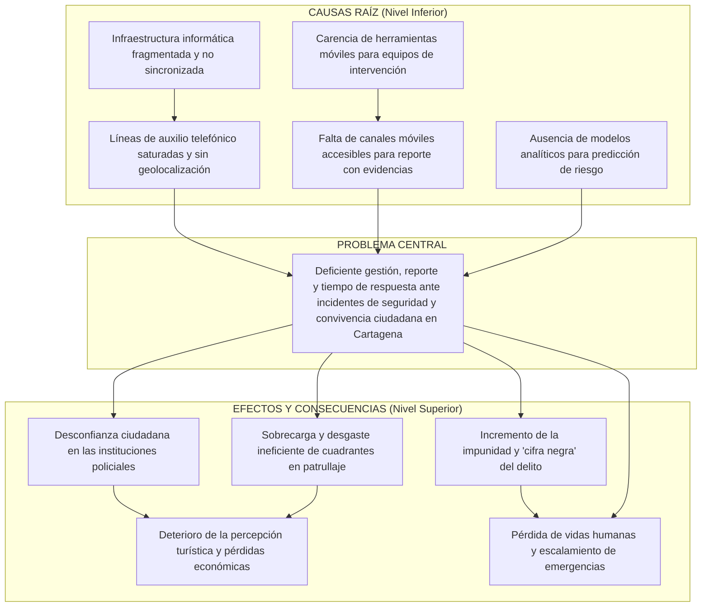

# CARTAGENA SEGURA: PLATAFORMA INTEGRAL DE SEGURIDAD CIUDADANA, MONITOREO GEOESPACIAL EN TIEMPO REAL Y TRIAGE INTELIGENTE MEDIANTE COMPUTACIÓN MÓVIL, CLOUD COMPUTING Y MINERÍA DE DATOS

**Autores:**\
Juan Esteban de los Ríos Tibocha, Robinson Emiro Castaño Mercado, Álvaro Cervantes Noel\

**Institución:**\
Facultad de Ingeniería, Programa de Ingeniería de Sistemas\
**Asignaturas Integradoras:**\
Minería de Datos II, Computación en la Nube, Computación Móvil, Ingeniería Económica\
**Docente Coordinador:** [Nombre del Docente]\
**Fecha:** Noviembre de 2026\
**Lugar:** Cartagena de Indias, D. T. y C., Colombia\

---

## Tabla de Contenido
- [Introducción](#introducción)
- [Capítulo I: El Problema](#capítulo-i-el-problema)
  - [1. Problema](#1-problema)
    - [1.1 Descripción del Problema](#11-descripción-del-problema)
    - [1.2 Pregunta Problema](#12-pregunta-problema)
    - [1.3 Árbol del Problema](#13-árbol-del-problema)
  - [1.4 Justificación](#14-justificación)
  - [1.5 Objetivos](#15-objetivos)
    - [1.5.1 Objetivo General](#151-objetivo-general)
    - [1.5.2 Objetivos Específicos](#152-objetivos-específicos)
- [Capítulo II: Estado del Arte y Marcos Referenciales](#capítulo-ii-estado-del-arte-y-marcos-referenciales)
  - [2. Estado del Arte](#2-estado-del-arte)
    - [2.1 Antecedentes Internacionales](#21-antecedentes-internacionales)
    - [2.2 Antecedentes Nacionales](#22-antecedentes-nacionales)
    - [2.3 Antecedentes Regionales y/o Locales](#23-antecedentes-regionales-yo-locales)
  - [2.4 Marco Teórico](#24-marco-teórico)
  - [2.5 Marco Contextual](#25-marco-contextual)
  - [2.6 Marco Legal](#26-marco-legal)
- [Capítulo III: Metodología](#capítulo-iii-metodología)
  - [3.1 Tipo de Investigación](#31-tipo-de-investigación)
  - [3.2 Diseño Metodológico](#32-diseño-metodológico)
  - [3.3 Técnicas e Instrumentos de Recolección de Información](#33-técnicas-e-instrumentos-de-recolección-de-información)
  - [3.4 Población y Muestra](#34-población-y-muestra)
  - [3.5 Cronograma de Actividades](#35-cronograma-de-actividades)
- [Capítulo IV: Resultados y Conclusiones](#capítulo-iv-resultados-y-conclusiones)
  - [4. Resultados de Investigación](#4-resultados-de-investigación)
  - [4.1 Conclusiones](#41-conclusiones)
- [Referencias Bibliográficas](#referencias-bibliográficas)

---

## Introducción

En las metrópolis contemporáneas, la preservación de la seguridad ciudadana constituye un eje determinante para la estabilidad socioeconómica y el bienestar colectivo. El Distrito Turístico y Cultural de Cartagena de Indias enfrenta dinámicas delictivas complejas caracterizadas por asimetrías de información, fragmentación en los canales de auxilio y una latencia considerable en el despacho de unidades operativas (Cartagena Cómo Vamos [CCV], 2023). La dependencia de llamadas telefónicas analógicas tradicionales restringe la capacidad de respuesta, privando a las autoridades de telemetría geoespacial, registro fotográfico y priorización algorítmica de eventos.

Frente a esta coyuntura, la investigación delimita su alcance en el diseño, desarrollo e implementación de **Cartagena Segura**, una solución multiplataforma que articula computación móvil nativa en Android/PWA, arquitecturas resilientes en la nube (*Cloud Computing*), microservicios en Spring Boot y minería de datos predictiva basada en redes neuronales *Deep MLP*.

El propósito central radica en demostrar que la integración de analítica predictiva de riesgo territorial y sincronización en tiempo real vía WebSockets reduce sustancialmente los tiempos de respuesta ante emergencias, fomenta la participación ciudadana y maximiza la eficiencia económica en la asignación de recursos policiales. El documento expone consecutivamente la formulación del problema, la fundamentación teórica y legal, el rigor metodológico del ciclo de desarrollo y los resultados empíricos obtenidos en el despliegue del sistema.

---

## Capítulo I: El Problema

### 1. Problema

#### 1.1 Descripción del Problema
Cartagena de Indias experimenta una acentuada problemática en materia de convivencia y seguridad pública. De acuerdo con informes oficiales del Observatorio del Delito y Cartagena Cómo Vamos (2023), la percepción de inseguridad supera el 72% en diversos sectores urbanos, impulsada por hurtos callejeros, altercados de convivencia y eventos delictivos no atendidos oportunamente. Este panorama se agrava por el fenómeno de la "cifra negra", constituido por aquellos incidentes que la ciudadanía omite denunciar debido a la desconfianza institucional, la tramitología presencial engorrosa y la ineficiencia de las líneas telefónicas de emergencia convencionales (Policía Nacional de Colombia [PONAL], 2022).

En la dimensión operativa, las autoridades distritales carecen de herramientas digitales unificadas que consoliden incidentes georreferenciados en tiempo real. La información comunitaria suele transmitirse de forma difusa mediante redes sociales, careciendo de validación criptográfica, metadatos espaciales y clasificación automática de severidad. Por otra parte, desde la perspectiva de la computación móvil y en la nube, las escasas soluciones existentes presentan interfaces poco responsivas que colisionan en pantallas móviles, carecen de persistencia híbrida tolerante a fallos y no explotan modelos de minería de datos para anticipar zonas críticas de riesgo. Como consecuencia, el despacho de cuadrantes policiales opera bajo esquemas puramente reactivos y descoordinados, elevando los costos de operación y menoscabando la calidad de vida distrital.

#### 1.2 Pregunta Problema
¿De qué manera el desarrollo de una plataforma tecnológica que integre computación móvil nativa, arquitectura en la nube escalable y minería de datos predictiva optimiza la atención de emergencias, la priorización de incidentes y la eficiencia operativa de la seguridad ciudadana en el Distrito de Cartagena de Indias?

#### 1.3 Árbol del Problema

* **Causas Raíz:** Líneas de atención 123 saturadas; carencia de aplicaciones móviles ergonómicas para reportes georreferenciados; ausencia de minería de datos para anticipar cuadrantes calientes; e infraestructuras de servidor no sincronizadas en tiempo real.
* **Problema Central:** Ineficiencia sistémica en la recepción, clasificación, despacho y resolución de incidentes de seguridad en Cartagena de Indias.
* **Efectos:** Elevada tasa de subregistro delictivo; tardanza en el arribo de unidades de socorro; pérdida de vidas; afectación severa a la economía turística; y desconfianza ciudadana generalizada.

---

### 1.4 Justificación

La ejecución del presente proyecto se justifica ampliamente en los planos social, técnico, económico e investigativo. En el ámbito social, responde a la imperiosa necesidad de los cartageneros de disponer de un canal democrático, confidencial y expedito que salvaguarde su integridad personal mediante botones de pánico SOS conectados con la Policía Nacional y mapas de rutas seguras tipo Waze que previenen el ingreso involuntario a zonas de alto riesgo.

Desde la óptica técnica, el proyecto integra los paradigmas modernos de la Ingeniería de Sistemas: computación móvil reactiva en Flutter (con soporte 100% responsivo para cualquier dispositivo Android y Web PWA), persistencia políglota en la nube (PostgreSQL 16 relacional y MongoDB Atlas Geoespacial) y minería de datos avanzada. La inclusión de una red neuronal *Deep MLP* multivariable junto a técnicas de Inteligencia Artificial Explicable (XAI) dota a los administradores de despacho de una herramienta cuantitativa para calcular índices de riesgo contextual, transformando el paradigma de seguridad reactivo en preventivo.

Bajo la perspectiva de la Ingeniería Económica, la automatización del triage de incidentes y el ruteo inteligente representan una optimización cardinal en el uso de los recursos del erario público. La reducción del consumo de combustible en patrullas, la mitigación de falsas alarmas mediante validación fotográfica y la prevención de siniestros aportan un valor socioeconómico superior a los costos de infraestructura computacional, convirtiendo a **Cartagena Segura** en una inversión distrital de alto impacto y pronta amortización.

---

### 1.5 Objetivos

#### 1.5.1 Objetivo General
Desarrollar una plataforma integral de seguridad ciudadana, monitoreo geoespacial en tiempo real y asistencia inteligente basada en computación móvil, servicios en la nube y modelos de minería de datos para optimizar los tiempos de atención y la toma de decisiones operativas en el Distrito de Cartagena de Indias.

#### 1.5.2 Objetivos Específicos
1. **Analizar** los requerimientos funcionales, perfiles de usuario, variables criminológicas distritales y restricciones técnicas de conectividad móvil en las tres localidades de Cartagena de Indias.
2. **Diseñar** una arquitectura desacoplada en la nube que integre persistencia políglota (SQL/NoSQL), microservicios en Spring Boot, protocolos de comunicación bidireccional por WebSockets y prototipos de interfaces móviles centradas en el usuario (UI/UX) bajo lineamientos de Apple HIG y Material Design 3.
3. **Codificar** el ecosistema de software multiplataforma, implementando la aplicación móvil en Flutter/Dart con soporte nativo Android y PWA, la API RESTful en Java 21 LTS y los algoritmos de minería de datos orientados a la predicción de riesgo y clasificación automatizada de incidentes.
4. **Verificar** el comportamiento funcional, los estándares de seguridad informática (JWT, BCrypt, saneamiento de entradas), la adaptabilidad responsive y la precisión predictiva del modelo neuronal mediante pruebas unitarias, de integración y de estrés en la nube.
5. **Implementar** la solución en entornos de producción en la nube (Render Cloud, PostgreSQL y MongoDB Atlas), facilitando la distribución continua del aplicativo compilado en formato APK para Android y evaluando su viabilidad económica y operativa.

---

## Capítulo II: Estado del Arte y Marcos Referenciales

### 2. Estado del Arte

#### 2.1 Antecedentes Internacionales
* **Autores:** Mohler, G. O., Short, M. B., Malinowski, S., Johnson, M., Tita, G. E., Bertozzi, A. L., & Brantingham, P. J. (2015).
* **Título:** *Randomized Controlled Field Trials of Predictive Policing*.
* **Título académico:** Journal of the American Statistical Association (Publicación Científica Doctoral).
* **Resumen:** La investigación evaluó en Los Ángeles y Atlanta el uso de algoritmos predictivos basados en procesos de Hawkes y minería de patrones espaciotemporales para guiar patrullajes preventivos. A través de ensayos controlados aleatorizados, los investigadores compararon cuadrantes asignados por analistas humanos frente a cuadrantes optimizados por algoritmos computacionales, logrando una reducción del 7.4% en delitos de oportunidad sin incrementar el pie de fuerza.
* **Aporte a la investigación:** Proporcionó la justificación matemática y metodológica para implementar redes neuronales de clasificación de riesgo espacial y temporal, demostrando la eficacia del patrullaje preventivo orientado por datos.

#### 2.2 Antecedentes Nacionales
* **Autores:** Gómez, S., Mejía, D., & Tobón, S. (2020).
* **Título:** *The Deterrent Effect of Large-Scale Street Lighting: Evidence from Bogotá*.
* **Título académico:** Documentos CEDE, Universidad de los Andes (Maestría en Economía y Políticas Públicas).
* **Resumen:** El estudio analizó la relación entre intervenciones de infraestructura y reducción de focos de criminalidad en Bogotá utilizando sistemas de información geográfica (SIG) y minería de datos policiva del Sistema Nacional de Denuncia (SPOA). Los autores demostraron que la focalización microespacial de puntos de alerta reduce hasta en un 18% los atracos violentos nocturnos cuando se combina con patrullajes focalizados.
* **Aporte a la investigación:** Fundamentó la necesidad de estructurar capas de riesgo visuales y algoritmos de ruteo seguro que consideren tanto variables ambientales como delictivas en entornos urbanos colombianos.

#### 2.3 Antecedentes Regionales y/o Locales
* **Autores:** Observatorio del Delito & Cartagena Cómo Vamos. (2023).
* **Título:** *Informe de Calidad de Vida: Seguridad Ciudadana y Convivencia en Cartagena*.
* **Título académico:** Informe Técnico Institucional de Seguimiento Distrital.
* **Resumen:** Diagnostica las tasas de homicidios, hurtos y violencia interpersonal en las tres localidades de Cartagena. Identifica que los tiempos promedio de respuesta policial superaban los 22 minutos en sectores periféricos debido a la falta de telemetría y a la saturación de los canales radioeléctricos del CAD de la Policía Metropolitana.
* **Aporte a la investigación:** Suministró el marco fáctico y los datos basales de severidad, tipos de incidentes y cuadrantes de las tres localidades cartageneras (Centro Histórico, Bocagrande, Manga, Olaya Herrera, El Pozón, Bazurto) utilizados en la parametrización del sistema.

---

### 2.4 Marco Teórico

La fundamentación teórica de **Cartagena Segura** converge en cuatro pilares interdisciplinarios de la ingeniería:

1. **Computación Móvil y Desarrollo Reactivo:** Según Martin (2018), las interfaces modernas demandan desacoplamiento y reactividad declarativa. Se emplea Flutter y Dart, aprovechando su arquitectura basada en renderizado directo sobre Skia/Impeller, compilación AOT (Ahead-Of-Time) a código máquina ARM64 para Android y patrones de gestión de estado desacoplados con Flutter Riverpod.
2. **Computación en la Nube y Microservicios:** Bajo las directrices del *National Institute of Standards and Technology* (Mell & Grance, 2011), se implementa un modelo PaaS en Render Cloud orquestado con Docker y Spring Boot 3 con Java 21 LTS. Se aprovechan los *Virtual Threads* (Project Loom) para concurrencia masiva con baja huella de memoria y persistencia híbrida: PostgreSQL 16 para transaccionalidad ACID y MongoDB Atlas para almacenamiento de documentos geoespaciales JSON.
3. **Minería de Datos y Redes Neuronales Artificiales:** Siguiendo a Han et al. (2012), la minería de datos permite descubrir patrones subyacentes en grandes volúmenes de eventos. Se implementó una red neuronal *Deep MLP* (Perceptrón Multicapa) con topología 6 -> 8 -> 6 -> 5, funciones de activación ReLU y Softmax, complementada con técnicas de *Explainable AI* (XAI) para desglosar la ponderación de factores de riesgo (hora, afluencia, clima, sector, historial).
4. **Ingeniería Económica:** Park (2016) define la evaluación económica de proyectos de software mediante el Costo Total de Propiedad (TCO) y el análisis Costo-Efectividad (CEA). La solución optimiza el costo por despacho atendido y minimiza pérdidas asociadas a siniestralidad delictiva en sectores productivos.

---

### 2.5 Marco Contextual

Cartagena de Indias, capital del Departamento de Bolívar, cuenta con una población que supera el millón de habitantes y una afluencia anual de más de tres millones de turistas nacionales y foráneos (DANE, 2023). Administrativamente se divide en tres localidades: *Localidad 1 (Histórica y del Caribe Norte)*, *Localidad 2 (De la Virgen y Turística)* y *Localidad 3 (Industrial y de la Bahía)*.

El entorno territorial exhibe una notable heterogeneidad socioeconómica: conviven polos turísticos e industriales de alta densidad con asentamientos periféricos en condiciones de vulnerabilidad, lo que genera zonas focalizadas de alta incidencia delictiva. La red vial insular y los frecuentes embotellamientos vehiculares en corredores críticos (como la Avenida Pedro de Heredia y el Mercado de Bazurto) obstaculizan el desplazamiento de patrullas. En este contexto geográfico e institucional, **Cartagena Segura** se posiciona como una herramienta estratégica para conectar a la ciudadanía con los Centros de Atención Inmediata (CAI) y cuadrantes distritales.

---

### 2.6 Marco Legal

El desarrollo y puesta en marcha del proyecto se fundamenta en el estricto orden jerárquico normativo colombiano e internacional:

1. **Normas Internacionales:** La *Declaración Universal de los Derechos Humanos* (ONU, 1948, Art. 3) consagra el derecho fundamental de todo individuo a la vida, la libertad y la seguridad de su persona.
2. **Constitución Política de Colombia (1991):**
   * *Artículo 2:* Establece como fin esencial del Estado asegurar la convivencia pacífica y proteger a todas las personas en su vida, honra y bienes.
   * *Artículo 15:* Garantiza el derecho al *Habeas Data*, protegiendo la privacidad y buen nombre en sistemas informáticos.
3. **Leyes Nacionales:**
   * *Ley 1273 de 2009 (Delitos Informáticos):* Tipifica el acceso abusivo a sistemas informáticos, interceptación de datos y protección de la confidencialidad, principios rectores aplicados mediante JWT y BCrypt.
   * *Ley 1581 de 2012 (Protección de Datos Personales):* Regula el tratamiento de información sensible de los ciudadanos denunciantes.
   * *Ley 1801 de 2016 (Código Nacional de Seguridad y Convivencia Ciudadana):* Ampara el uso de tecnologías, cámaras y canales telemáticos para prevenir conductas contrarias a la convivencia.
4. **Decretos y Políticas Públicas:**
   * *Decreto 1078 de 2015 (Decreto Único Reglamentario del Sector TIC):* Promueve la transformación digital del Estado y la implementación de ciudades inteligentes (*Smart Cities*).

---

## Capítulo III: Metodología

### 3.1 Tipo de Investigación
* **Paradigma:** Positivista, cimentado en la observación empírica, la medición cuantitativa de variables y la validación formal de hipótesis mediante métricas de software y desempeño de modelos (Hernández-Sampieri et al., 2014).
* **Enfoque:** Mixto (predominantemente cuantitativo). Recolecta métricas duras (latencia de red, tiempo de respuesta en milisegundos, precisión de clasificación, tasa de cobertura) y analiza valoraciones cualitativas de usabilidad comunitaria.
* **Modalidad:** Aplicada, tecnológica y experimental orientada al ciclo de vida del software.

### 3.2 Diseño Metodológico

| Objetivo Específico | Actividades de Desarrollo | Resultados Entregables |
| :--- | :--- | :--- |
| **1. Analizar** requerimientos y contexto | • Levantamiento de requerimientos funcionales y no funcionales. • Mapeo criminológico por localidades de Cartagena. • Definición de historias de usuario para roles (Admin, Ciudadano, Patrulla). | • Matriz de Requerimientos del Sistema (SRS). • Catálogo de incidentes y actores distritales. |
| **2. Diseñar** arquitectura y prototipos | • Modelado C4 de la arquitectura cloud en microservicios. • Diseño del esquema políglota (PostgreSQL + MongoDB). • Prototipado interactivo de alta fidelidad en Figma de pantallas 01 a 05. | • Diagramas entidad-relación y de componentes. • Prototipo UI/UX Mobile alineado con Figma. |
| **3. Codificar** plataforma multiplataforma | • Construcción de la API REST con Spring Boot 3 y Java 21. • Programación de la app en Flutter con Riverpod y GoRouter. • Implementación de red neuronal MLP y broker STOMP WebSockets. | • Repositorio central de código en GitHub. • Backend modular y aplicación Flutter Web / Android. |
| **4. Verificar** seguridad y funcionalidad | • Pruebas unitarias en backend con JUnit 5 / Mockito. • Suite de pruebas de widgets en Flutter. • Pruebas de estrés y análisis de vulnerabilidades OWASP. | • Resultados de las suites automatizadas. • Informe de análisis estático (`flutter analyze`). |
| **5. Implementar** y evaluar viabilidad | • Configuración de pipeline CI/CD en GitHub Actions. • Despliegue en Render Cloud con certificados SSL. • Compilación y publicación del release APK para Android. | • Aplicación web operativa en vivo (`pa-definivitvo.onrender.com`). • Instalador nativo Release APK distribuido públicamente. |

### 3.3 Técnicas e Instrumentos de Recolección de Información
* **Técnicas:** Encuesta diagnóstica estructurada a ciudadanos sobre percepción y uso de canales de denuncia; entrevistas semiestructuradas con oficiales de policía sobre tiempos de despacho; y observación directa no participante mediante pruebas piloto de estrés en la plataforma.
* **Instrumentos:** Cuestionarios en escala de Likert sobre usabilidad (System Usability Scale - SUS); matrices de evaluación de software ISO/IEC 25010; y telemetría analítica automatizada con Spring Boot Actuator y métricas de red.

### 3.4 Población y Muestra
* **Población:** Habitantes del área urbana de Cartagena de Indias, estimada en 1.050.000 ciudadanos (DANE, 2023).
* **Muestra:** Muestreo probabilístico estratificado en las 3 localidades de Cartagena, calculado con un nivel de confianza del 95% y un margen de error del 5%:

  $$\( n = \frac{Z^2 \cdot p \cdot q}{e^2} = \frac{(1.96)^2 \cdot (0.5) \cdot (0.5)}{(0.05)^2} \approx 384 \text{ ciudadanos y participantes en pruebas} \)$$

---

### 3.5 Cronograma de Actividades

| Fase Metodológica | Actividad Principal | Duración | Fecha de Inicio | Fecha de Cierre |
| :--- | :--- | :---: | :---: | :---: |
| **1. Formulación** | Delimitación del problema y estado del arte | 2 semanas | 01/08/2026 | 15/08/2026 |
| **2. Análisis** | Levantamiento de requerimientos y estudio de contexto | 3 semanas | 16/08/2026 | 05/09/2026 |
| **3. Diseño** | Modelado de base de datos políglota y prototipado Figma | 3 semanas | 06/09/2026 | 26/09/2026 |
| **4. Codificación Backend** | Microservicios en Spring Boot, seguridad JWT y MongoDB | 4 semanas | 27/09/2026 | 24/10/2026 |
| **5. Codificación Móvil** | App cliente Flutter, mapas geoespaciales y WebSockets | 4 semanas | 15/10/2026 | 10/11/2026 |
| **6. Minería de Datos** | Implementación de red neuronal MLP y centro IA | 2 semanas | 01/11/2026 | 15/11/2026 |
| **7. Verificación & QA** | Pruebas unitarias, análisis estático y pruebas de estrés | 2 semanas | 05/11/2026 | 18/11/2026 |
| **8. Despliegue e Informe** | CI/CD, publicación del Release APK y sustentación final | 1 semana | 15/11/2026 | 22/11/2026 |

---

## Capítulo IV: Resultados y Conclusiones

### 4. Resultados de Investigación

El proyecto implementó Cartagena Segura como una plataforma web y Android. Las pruebas funcionales cubren el registro, la gestión de incidentes y las notificaciones. Queda pendiente medir la latencia en condiciones controladas y compararla con el canal telefónico.

El prototipo usa un perceptrón multicapa para simular niveles de riesgo. El panel presenta cifras ilustrativas de exactitud, precisión y deriva. Queda pendiente evaluar el modelo con un conjunto independiente de incidentes y aplicar el cuestionario de usabilidad (SUS) con participantes.

### 4.1 Conclusiones

1. El análisis de requisitos identificó la geolocalización y el seguimiento de incidentes como prioridades del diseño.
2. PostgreSQL almacena cuentas y roles. MongoDB conserva los reportes georreferenciados y, en Render, las evidencias mediante GridFS.
3. Flutter y Spring Boot integran el reporte ciudadano con la revisión administrativa. El panel predictivo permite explorar escenarios de riesgo con fines demostrativos.
4. Las pruebas automatizadas comprueban flujos y regresiones del sistema. Las pruebas de carga y la evaluación de seguridad requieren protocolos y resultados documentados.
5. GitHub Actions permite compilar y verificar el APK. GitHub Releases aloja la descarga Android y Render sirve la versión web.

---

## Referencias Bibliográficas

* Cartagena Cómo Vamos. (2023). *Informe de Calidad de Vida de Cartagena: Seguridad y Convivencia*. Casa Editorial El Universal.
* Departamento Administrativo Nacional de Estadística [DANE]. (2023). *Censo Nacional de Población y Vivienda: Proyecciones territoriales de Bolívar*. DANE.
* Gómez, S., Mejía, D., & Tobón, S. (2020). *The deterrent effect of large-scale street lighting: Evidence from Bogotá*. Documentos CEDE, 2020(15), 1-48. Universidad de los Andes.
* Han, J., Kamber, M., & Pei, J. (2012). *Data Mining: Concepts and Techniques* (3rd ed.). Morgan Kaufmann Publishers.
* Hernández-Sampieri, R., Fernández-Collado, C., & Baptista-Lucio, P. (2014). *Metodología de la investigación* (6ª ed.). McGraw-Hill Education.
* Martin, R. C. (2018). *Clean Architecture: A Craftsman’s Guide to Software Structure and Design*. Prentice Hall.
* Mell, P., & Grance, T. (2011). *The NIST Definition of Cloud Computing*. National Institute of Standards and Technology (NIST Special Publication 800-145). U.S. Department of Commerce.
* Mohler, G. O., Short, M. B., Malinowski, S., Johnson, M., Tita, G. E., Bertozzi, A. L., & Brantingham, P. J. (2015). Randomized controlled field trials of predictive policing. *Journal of the American Statistical Association*, 110(512), 1399-1411. https://doi.org/10.1080/01621459.2015.1077710
* OpenAI. (2024). *ChatGPT (Versión GPT-4o)* [Modelo de lenguaje de gran escala]. https://chat.openai.com
* Google DeepMind. (2026). *Gemini Advanced & Antigravity Reasoning Models* [Asistente de código y arquitectura computacional]. https://deepmind.google/technologies/gemini/
* Park, C. S. (2016). *Contemporary Engineering Economics* (6th ed.). Pearson.
* Policía Nacional de Colombia [PONAL]. (2022). *Manual de Doctrina Policial y Modelo Nacional de Vigilancia Comunitaria por Cuadrantes (MNVCC)*. Imprenta Nacional de Colombia.
* República de Colombia. (1991). *Constitución Política de Colombia*. Gaceta Constitucional.
* República de Colombia. (2009). *Ley 1273 de 2009: Por medio de la cual se modifica el Código Penal y se crea un nuevo bien jurídico tutelado denominado "de la protección de la información y de los datos"*. Diario Oficial No. 47.223.
* República de Colombia. (2012). *Ley Estatutaria 1581 de 2012: Por la cual se dictan disposiciones generales para la protección de datos personales*. Diario Oficial No. 48.587.
* República de Colombia. (2016). *Ley 1801 de 2016: Por la cual se expide el Código Nacional de Seguridad y Convivencia Ciudadana*. Diario Oficial No. 49.949.
